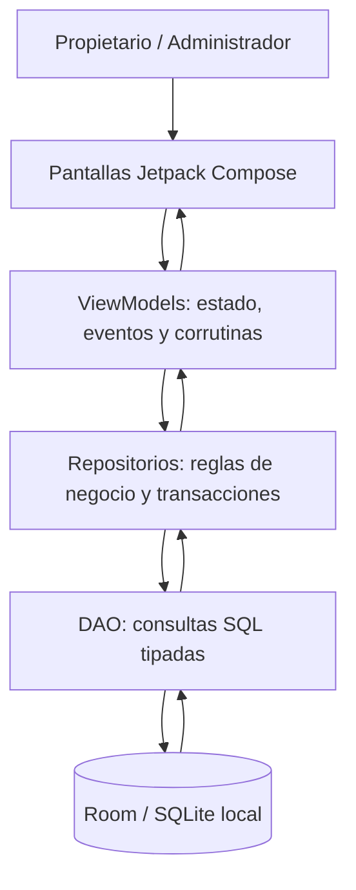

# 03 · Arquitectura técnica

## Flujo de responsabilidades

**Una pantalla** captura datos y muestra mensajes; **un ViewModel** gestiona el estado y lanza trabajos con `viewModelScope`; **un repositorio** valida el proceso; **un DAO** realiza SQL; **Room** conserva registros localmente. Las consultas DAO observables utilizan `Flow`, que permite actualizar la UI ante cambios.

## Archivos centrales

| Carpeta / archivo | Responsabilidad |
|---|---|
| `MainActivity.kt` | Configura el tema y el punto de entrada Compose |
| `navigation/Routes.kt` | Rutas y parámetros de pantallas existentes |
| `navigation/AppNavigation.kt` | `NavHost`, callbacks, configuración de ViewModels |
| `ui/inicio/` | Panel de ocupación y alertas de contratos |
| `ui/propiedades/` | Listado, formularios, detalle de propiedad y habitaciones |
| `ui/contratos/` | Inquilinos y contratos, formularios, edición y finalización |
| `ui/components/` | Controles, tarjetas y navegación reutilizables |
| `ui/theme/` | Color, tipografía y tema Material 3 |
| `data/local/entity/` | Diez clases persistentes, FK e índices |
| `data/local/dao/` | Diez interfaces SQL tipadas |
| `data/local/RentaCuartoDatabase.kt` | Versión Room, DAOs, migración 1→2 y Singleton |
| `data/repository/` | Reglas de negocio, transacciones, cálculos y consultas económicas |
| `util/` | Fechas ISO y dinero en céntimos |

## Ejemplo: registrar una propiedad

`PropiedadFormScreen` → `PropiedadesViewModel.guardar` → `PropiedadesRepository.guardarPropiedad` → `PropiedadDao.insertar` → tabla `propiedades`. El listado se actualiza por `Flow`.

## Ejemplo: registrar un contrato

`ContratoFormScreen` → `ContratosViewModel.registrar` → `ContratosRepository.registrar`. Dentro de una transacción se comprueba la habitación, el inquilino, las fechas y el conflicto contractual. Se inserta contrato y, si corresponde, un depósito **pactado** sin suponer que se haya recibido.

## Ejemplo preparado: registrar un abono

El futuro ViewModel de Cobros invocará `CobrosRepository.registrarAbono`, que comprueba el contrato e importe, guarda el movimiento `origen=EFECTIVO`, distribuye primero a las rentas antiguas y reescribe `aplicaciones_abono` en una transacción. La pantalla de Cobros todavía no está implementada.

## Decisiones técnicas

- Una sola instalación, un propietario, datos locales. **No se implementó API REST, Firebase ni sincronización.**
- Ocupación y saldos **calculados**, no columnas redundantes permanentes.
- Dinero en `Long` céntimos; no se utilizan `Float` o `Double` para pagos.
- Fechas ISO; `coreLibraryDesugaring` permite usar `java.time` desde API 24.
- Las operaciones financieras utilizan transacciones Room para modificar filas relacionadas de manera atómica.

## Dependencias principales

Kotlin, AndroidX Core, Activity Compose, Compose BOM/UI/Material 3, Navigation Compose, Lifecycle ViewModel, Room Runtime/KTX/Compiler, KSP, JUnit, AndroidX Test y Espresso. Las versiones exactas están en [`gradle/libs.versions.toml`](../gradle/libs.versions.toml).
