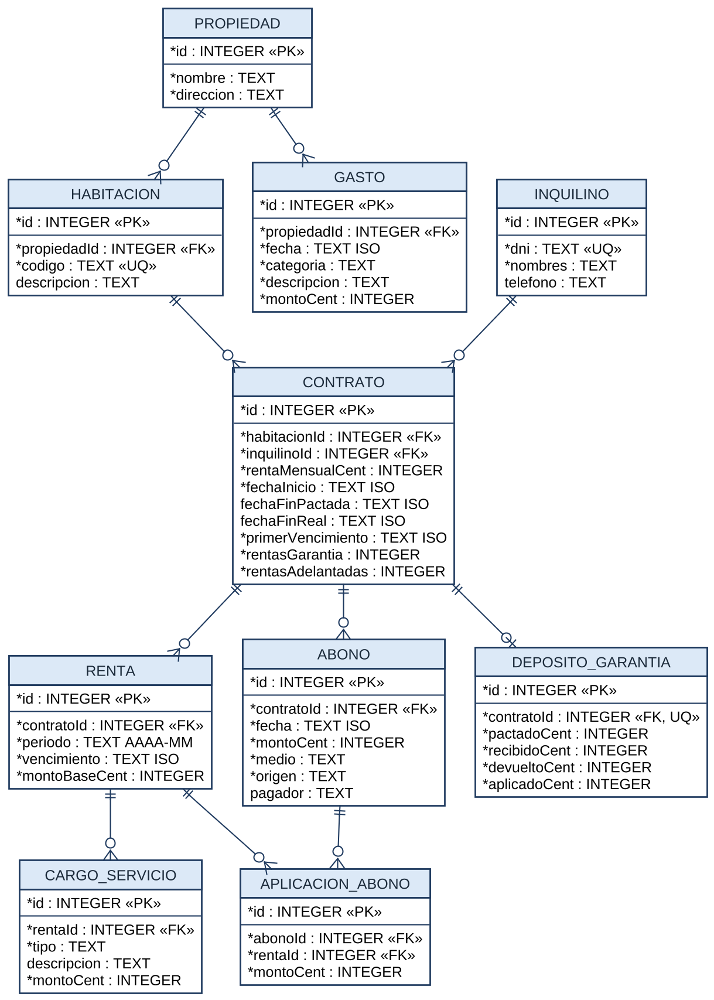
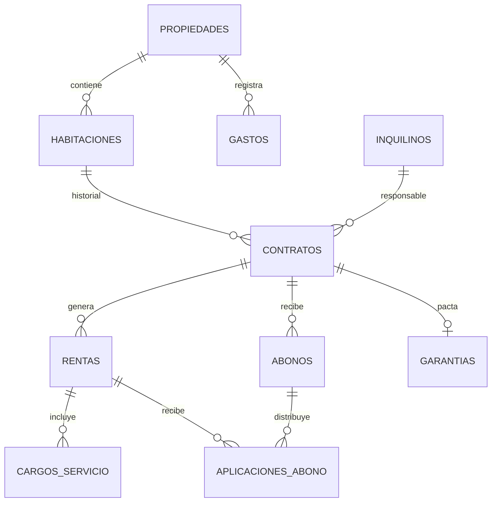

# 04 · Modelo de datos Room / SQLite

**Fuente principal:** capítulo 6 del [documento UML](referencias/RentaCuarto_Proyecto_UML_Profesional.docx). El modelo contempla **diez tablas**. Este repositorio conserva los nombres físicos de las cuatro tablas iniciales y agrega seis tablas económicas.

## Entidades y relaciones

| Entidad Kotlin / tabla SQLite | Contenido principal | Relación |
|---|---|---|
| `PropiedadEntity` / `propiedades` | Nombre, dirección, tipo, notas | 1 propiedad → N habitaciones y gastos |
| `HabitacionEntity` / `habitaciones` | Código único por propiedad, descripción | N habitaciones → 1 propiedad |
| `InquilinoEntity` / `inquilinos` | DNI único, nombre, teléfono | 1 inquilino → N contratos históricos |
| `ContratoEntity` / `contratos` | Habitación, inquilino, fechas, renta, garantías pactadas | 1 contrato → N rentas/abonos; 0..1 garantía |
| `RentaEntity` / `rentas` | Periodo, vencimiento, renta base histórica | Unique `(contrato_id, periodo)` |
| `CargoServicioEntity` / `cargos_servicio` | Tipo, monto, descripción, anulación | N cargos → 1 renta |
| `AbonoEntity` / `abonos` | Fecha, medio, **origen**, importe, anulación | N abonos → 1 contrato; puede ligar garantía |
| `AplicacionAbonoEntity` / `aplicaciones_abono` | Abono, renta, importe aplicado | Registra asignación auditable por renta |
| `GarantiaEntity` / `garantias` | Pactado, recibido, devuelto y aplicado | Única por contrato |
| `GastoEntity` / `gastos` | Propiedad, categoría, fecha, importe, anulado | N gastos → 1 propiedad |

## Decisiones del esquema físico

1. **La ocupación no es columna de Habitación.** Se obtiene de los contratos que abarcan la fecha consultada.
2. **Las fechas se guardan como `TEXT` ISO** (`AAAA-MM-DD`); los periodos, como `AAAA-MM`.
3. **Los importes se guardan como `INTEGER` / `Long` en céntimos**, por ejemplo, S/ 530 = `53000`.
4. El depósito pactado se inserta al registrar contrato, pero `recibidoCent` comienza en **cero**; nunca equivale automáticamente a dinero recibido.
5. Se utiliza `Abono.origen`: **`EFECTIVO`** para un pago real e **`GARANTIA`** para una aplicación interna. `medio` es independiente (`EFECTIVO`, `YAPE`, `TRANSFERENCIA`, `INTERNO`, etc.).
6. Las anulaciones de abonos, cargos y gastos son lógicas, sin borrado físico. Las correcciones de abonos conservan la fila previa como anulada.
7. La entidad `AplicacionAbonoEntity` usa clave artificial `id` más índice único `(abono_id, renta_id)`, de acuerdo con el diccionario de datos del documento reciente.
8. En los DAO se usa FK `RESTRICT` para proteger el historial de relaciones.

## Diagrama simplificado

## Migración de esquema

El primer avance tenía **Room v1** con cuatro entidades. La migración `MIGRACION_1_2` en `RentaCuartoDatabase.kt` crea seis nuevas tablas, índices y claves foráneas y construye garantías pactadas para los contratos ya guardados. No elimina ni reescribe los cuatro catálogos iniciales. **No hay `fallbackToDestructiveMigration()`.**

> Importante: una migración Room conserva datos **dentro de la misma instalación y del mismo archivo de base de datos**. Cambiar el `applicationId` del antiguo proyecto experimental a `com.rentacuarto` crea otra instalación y no transfiere datos por sí solo.

## Lo que todavía falta madurar

- Guardar versiones antiguas de los **esquemas JSON de Room** y ejecutar pruebas de migración formal con `MigrationTestHelper`.
- Evaluar una tabla adicional de **auditoría de recepción y devolución de garantías con fecha y medio**. El UML de diez entidades guarda saldos agregados, no todos los eventos.
- Implementar la desactivación lógica de propiedades (RF01) y los filtros por fecha configurables.
- Asegurar pruebas con datos acumulados en más de una versión de Android.
