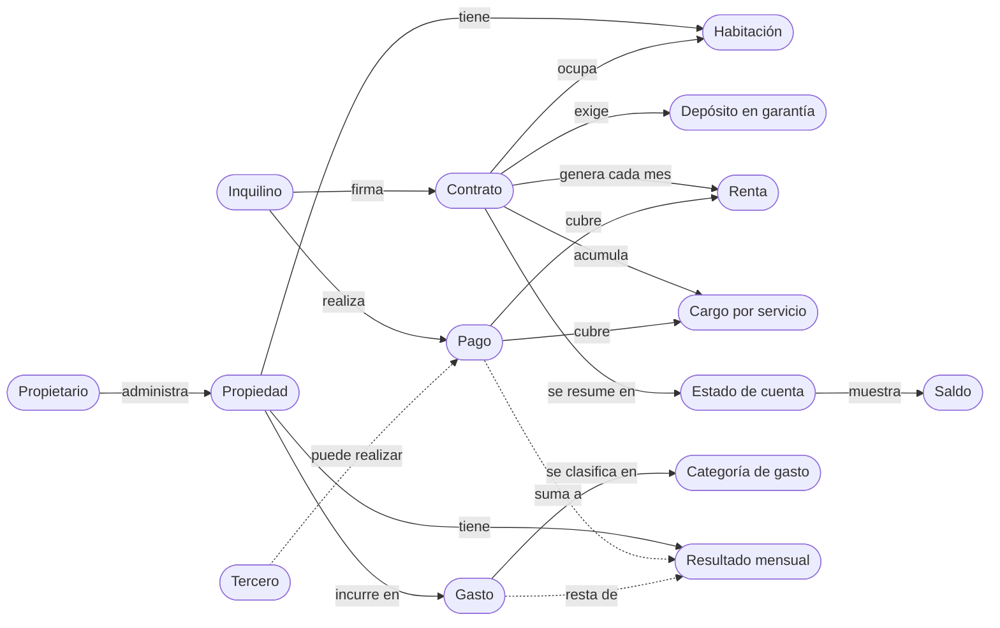
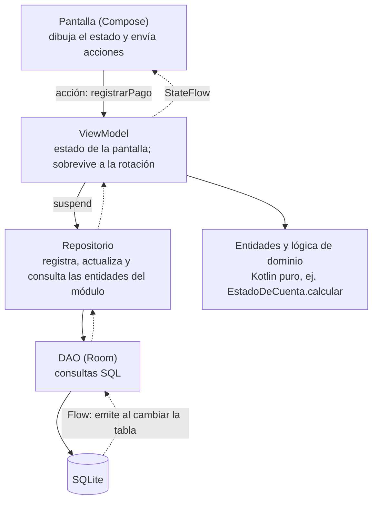
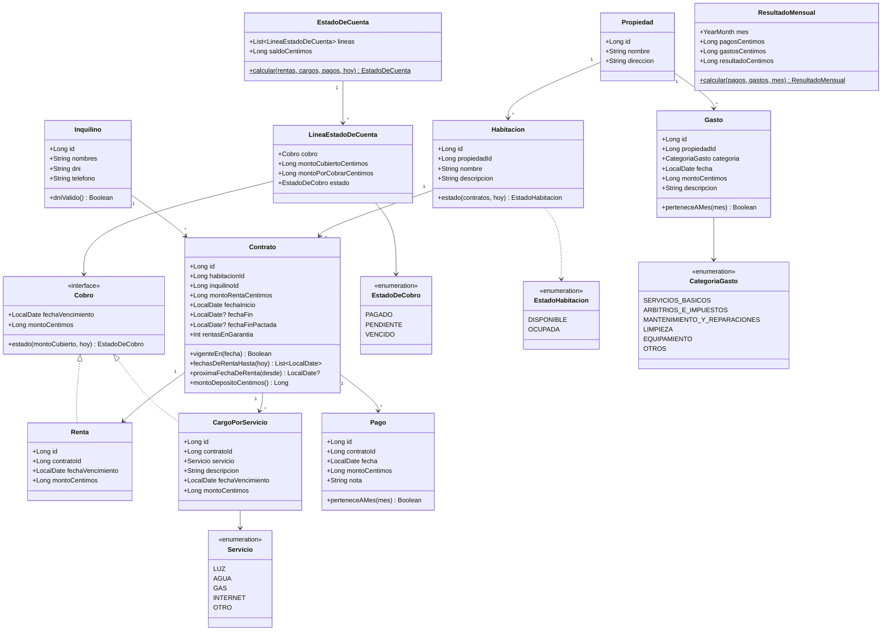
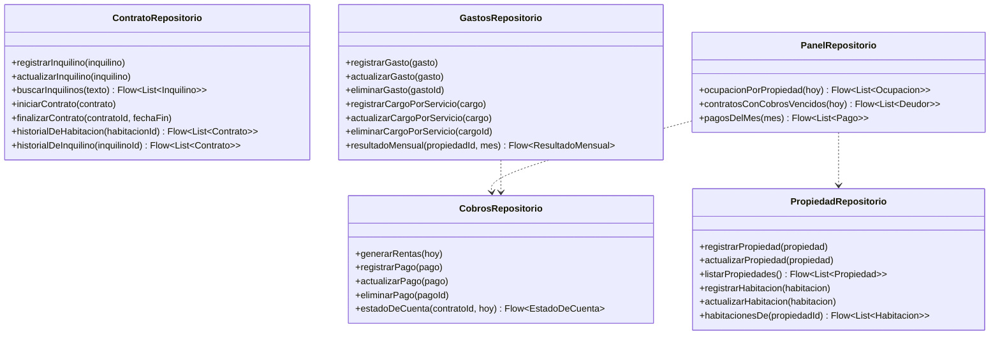
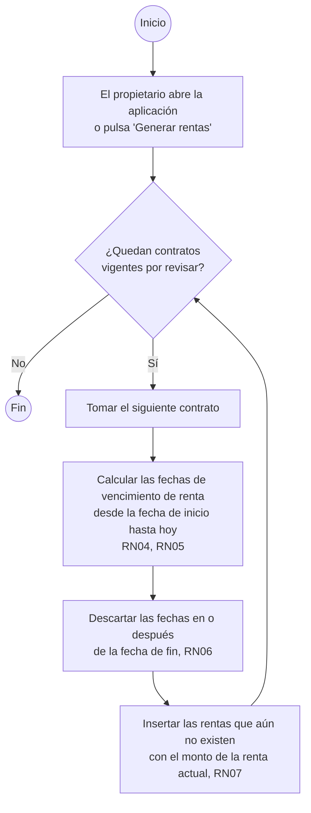
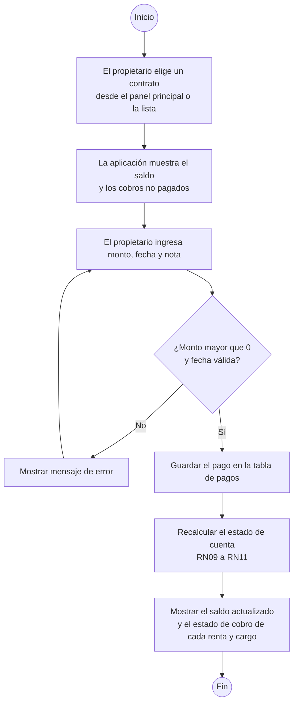
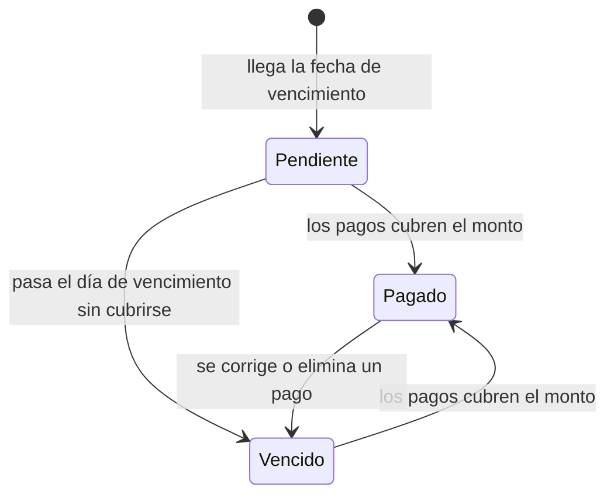
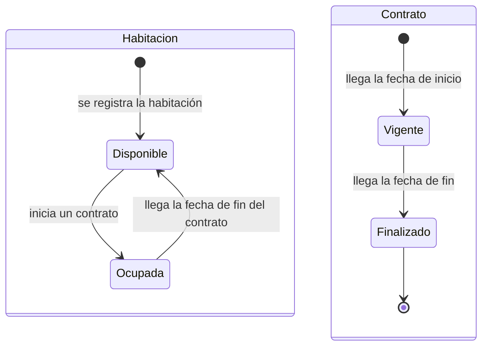
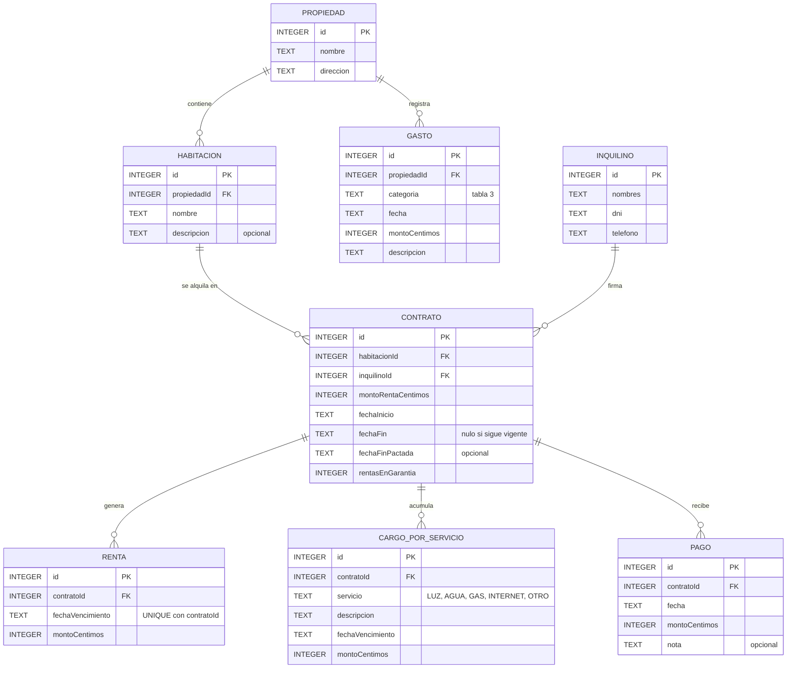
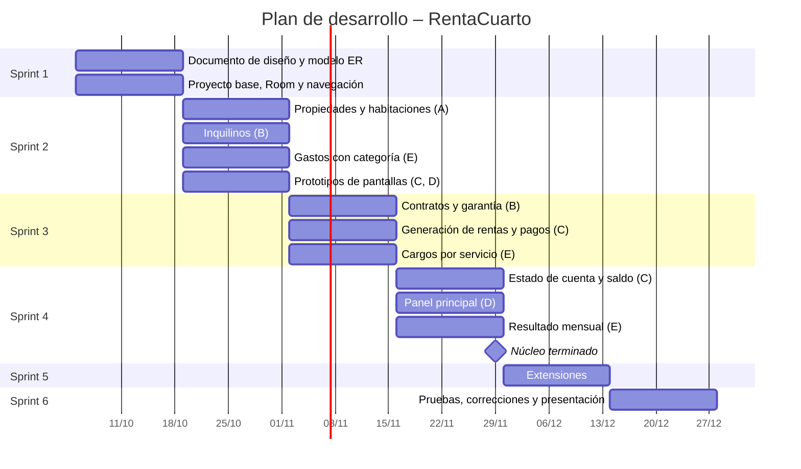

# Documento de Diseño – RentaCuarto

**“Sistema móvil para la gestión de habitaciones en alquiler, pagos y control de propiedades”**

**Universidad Nacional Mayor de San Marcos** – Facultad de Ingeniería de Sistemas e Informática
**Asignatura:** Desarrollo de Sistemas Móviles – **Docente:** Enrique Gustavo Chala Mena
**Grupo 10 – Estudiantes:**

- Huanacuni Gomez JeanCarlos – 23200181
- Quispe Ñahui Alvaro Jesus – 23200050
- Quispe Carbajal Kevin Hernando – 22200137
- Tafur Ari Marco Alejandro – 23200218
- Contreras Peña Rodrigo – 23200016

**Lima, Perú – 2026**

---

## Presentación del proyecto

**RentaCuarto** es una aplicación móvil Android para pequeños y medianos propietarios que alquilan habitaciones como vivienda por meses, dentro de casas o edificios. Con ella, el propietario registra sus propiedades, habitaciones, inquilinos y contratos, lo que cobra a cada inquilino (rentas y cargos por servicios como luz y agua), los pagos que recibe y los gastos de cada propiedad.

**Problema que resuelve.** El propietario lleva el control en cuadernos, hojas de cálculo, mensajes y comprobantes sueltos. Por eso le cuesta saber con rapidez qué habitaciones están ocupadas, quién le debe y cuánto, qué contratos están por terminar y cuánto le deja realmente cada propiedad después de los gastos.

**Solución.** Una aplicación de un solo usuario, el propietario, que funciona sin conexión a internet y guarda la información en el propio teléfono. El inquilino paga como siempre (efectivo, Yape, transferencia) y el propietario registra el pago; la aplicación calcula al instante la deuda de cada contrato y el resultado de cada propiedad, y permite compartir con el inquilino su estado de cuenta.

**Tabla 1. Correspondencia con la estructura solicitada**

| N.º | Punto solicitado | Sección |
|:---:|---|:---:|
| – | Diccionario de términos | Diccionario |
| 1 | Objetivos del proyecto | 1 |
| 2 | Requerimientos funcionales | 2 |
| 3 | Requerimientos no funcionales (incluye reglas de negocio) | 3 |
| 4 | Modelo conceptual | 4 |
| 5 | Modelado UML: clases, actividades y estados | 5 |
| 6 | Modelamiento de datos | 6 |
| 7 | Proceso de desarrollo (Gantt) | 7 |
| 8 | Distribución de la carga | 8 |

---

## Diccionario de términos

Estos términos se usan con este significado exacto en todo el documento, en los diagramas y en el código.

**Tabla 2. Diccionario de términos**

| Término | Definición |
|---|---|
| Propietario | Persona que administra las propiedades y único usuario de la aplicación, sea o no el dueño legal (arrendador). |
| Inquilino | Persona responsable de un contrato (arrendatario). No usa la aplicación. |
| Propiedad | Casa o edificio del propietario con habitaciones que alquila como vivienda por meses. |
| Habitación | Unidad que se alquila dentro de una propiedad; está disponible u ocupada. |
| Contrato | Acuerdo por el que un inquilino ocupa una habitación pagando un monto de renta mensual desde una fecha de inicio. Registra además las rentas en garantía y, si se acordó, la fecha de fin pactada. |
| Fecha de fin | Día en que el contrato termina realmente. Mientras no se registra, el contrato sigue vigente. |
| Fecha de fin pactada | Plazo acordado al firmar el contrato. Es informativa: no termina el contrato. |
| Depósito en garantía | Dinero que el inquilino entrega al iniciar el contrato, igual a un número de rentas (rentas en garantía). No forma parte del saldo. |
| Cobro | Todo monto que el inquilino debe pagar: una renta o un cargo por servicio. |
| Renta | Cobro mensual de un contrato (merced conductiva) por el monto de la renta completo. Vence cada mes el mismo día en que empezó el contrato. |
| Cargo por servicio | Cobro que el propietario registra por el consumo de un servicio de la habitación (luz, agua, gas, internet u otro), con el monto que él determina. |
| Estado de cobro | Pagado, pendiente o vencido (ver RN11). |
| Pago | Abono que recibe el propietario, registrado contra un contrato. Puede hacerlo el inquilino o un tercero. |
| Saldo | Total de cobros de un contrato menos total de pagos. Positivo: deuda. Negativo: saldo a favor del inquilino. |
| Estado de cuenta | Lista cronológica de los cobros y pagos de un contrato con el saldo acumulado (ver sección 2.2). |
| Línea del estado de cuenta | Un cobro dentro del estado de cuenta, con el monto cubierto por los pagos, el monto por cobrar y su estado de cobro. |
| Gasto | Dinero que el propietario paga por una propiedad, clasificado en una categoría de gasto. |
| Categoría de gasto | Servicios básicos, arbitrios e impuestos, mantenimiento y reparaciones, limpieza, equipamiento u otros (ver tabla 3). |
| Gasto de servicio | Gasto de la categoría servicios básicos: lo que el propietario paga a la empresa de luz, agua, gas o internet. No es un cargo por servicio, que es lo que el inquilino le debe al propietario. |
| Resultado mensual | Pagos recibidos en un mes por los contratos de una propiedad menos los gastos de esa propiedad en ese mes. |

**Tabla 3. Categorías de gasto**

| Categoría | Ejemplos |
|---|---|
| Servicios básicos | Recibos de luz, agua, gas e internet de la propiedad. |
| Arbitrios e impuestos | Arbitrios municipales, impuesto predial. |
| Mantenimiento y reparaciones | Gasfitería, pintura, cerraduras, electricidad. |
| Limpieza | Limpieza de áreas comunes, productos de limpieza. |
| Equipamiento | Camas, colchones, muebles y electrodomésticos de las habitaciones. |
| Otros | Gastos que no corresponden a las categorías anteriores. |

---

## 1. Objetivos del proyecto

### 1.1 Objetivo general

Brindar a los pequeños propietarios de habitaciones en alquiler una herramienta móvil que les permita conocer en todo momento la ocupación, las deudas de sus inquilinos y la rentabilidad de cada propiedad, reemplazando el control disperso en cuadernos y hojas de cálculo.

### 1.2 Objetivos específicos

1. Que el propietario conozca de inmediato qué habitaciones están disponibles para alquilar, sin revisar registros en papel.
2. Facilitar el cobro oportuno, identificando el mismo día en que vence cada renta o cargo qué inquilinos están atrasados y cuánto deben.
3. Contar con una única fuente confiable de lo que cada inquilino debe y ha pagado, que pueda compartirse con él y evite discrepancias.
4. Que el propietario conozca cuánto le deja realmente cada propiedad cada mes, después de descontar sus gastos.
5. Garantizar que la información esté disponible sin conexión a internet y se conserve aunque se pierda o cambie el teléfono.

---

## 2. Requerimientos funcionales

### 2.1 Alcance funcional

El sistema se organiza en cinco módulos; cada uno tiene un responsable (sección 8).

- **A. Propiedades y habitaciones:** registro de propiedades y de sus habitaciones, con su disponibilidad calculada a partir de los contratos.
- **B. Inquilinos y contratos:** registro de inquilinos, inicio y fin de contratos con su monto de renta, rentas en garantía y fecha de fin pactada.
- **C. Rentas y pagos:** generación automática de las rentas, registro de pagos y cálculo del estado de cuenta de cada contrato.
- **D. Panel principal:** resumen de la ocupación, los pagos del mes y los contratos con cobros vencidos.
- **E. Gastos y cargos por servicio:** registro de gastos por categoría, registro de cargos por servicio a los inquilinos y cálculo del resultado mensual de cada propiedad.

**Prioridad:** _Núcleo_ = comprometido para la entrega final. _Extensión_ = se implementa solo si el núcleo está terminado (sprint 5).

**Tabla 4. Requerimientos funcionales**

| ID | Requerimiento | Módulo | Prioridad |
|:---:|---|:---:|:---:|
| RF01 | Registrar, editar y listar propiedades. | A | Núcleo |
| RF02 | Registrar, editar y listar las habitaciones de cada propiedad. | A | Núcleo |
| RF03 | Consultar si cada habitación está disponible u ocupada. | A | Núcleo |
| RF04 | Registrar, editar y buscar inquilinos (nombres, DNI, teléfono). | B | Núcleo |
| RF05 | Iniciar un contrato: habitación disponible, inquilino, monto de la renta, fecha de inicio, rentas en garantía y, opcionalmente, fecha de fin pactada. | B | Núcleo |
| RF06 | Finalizar un contrato registrando su fecha de fin. | B | Núcleo |
| RF07 | Consultar el historial de contratos de una habitación y de un inquilino. | B | Núcleo |
| RF08 | Generar las rentas de cada contrato vigente al abrir la aplicación o a pedido. | C | Núcleo |
| RF09 | Registrar, editar y eliminar pagos de un contrato. | C | Núcleo |
| RF10 | Calcular el estado de cobro de cada renta y cargo por servicio, y el saldo del contrato. | C | Núcleo |
| RF11 | Consultar el estado de cuenta de un contrato (sección 2.2). | C | Núcleo |
| RF12 | Consultar en el panel principal la ocupación por propiedad (ocupadas / total). | D | Núcleo |
| RF13 | Consultar los contratos con cobros vencidos y el monto adeudado. | D | Núcleo |
| RF14 | Consultar los pagos recibidos en el mes actual. | D | Núcleo |
| RF15 | Registrar, editar y eliminar gastos de una propiedad, con su categoría de gasto. | E | Núcleo |
| RF16 | Consultar el resultado mensual de cada propiedad (cálculo en RN13). | E | Núcleo |
| RF17 | Notificar los cobros vencidos y los contratos cuya fecha de fin pactada está próxima. | B | Extensión |
| RF18 | Registrar la devolución del depósito en garantía, o su aplicación a la deuda, al finalizar un contrato. | B | Extensión |
| RF19 | Compartir el estado de cuenta de un contrato o una constancia de pago por WhatsApp u otra aplicación. | C | Extensión |
| RF20 | Consultar reportes de deuda y ocupación por rango de fechas. | D | Extensión |
| RF21 | Registrar, editar y eliminar cargos por servicio de un contrato. | E | Núcleo |
| RF22 | Consultar información gráfica de los gastos por categoría y del resultado mensual. | E | Extensión |
| RF23 | Calcular el cargo por servicio de luz a partir de la lectura anterior, la lectura actual y la tarifa. | E | Extensión |

### 2.2 Estado de cuenta

El estado de cuenta (RF11, RF19) es el resumen de lo que un inquilino debe y ha pagado en un contrato. Consta de:

**Tabla 5. Atributos del estado de cuenta**

| Atributo | Descripción |
|---|---|
| Inquilino y habitación | A quién y por qué habitación corresponde el contrato. |
| Movimientos | Lista cronológica de cobros (rentas y cargos por servicio) y pagos, cada uno con fecha, concepto, monto y saldo acumulado. |
| Líneas del estado de cuenta | Por cada cobro: monto, monto cubierto por los pagos, monto por cobrar y estado de cobro (pagado, pendiente o vencido). |
| Saldo | Total de cobros menos total de pagos a la fecha de consulta. |
| Fecha de consulta | Día en que se calcula; los estados de cobro dependen de ella. |

---

## 3. Requerimientos no funcionales

### 3.1 Especificaciones del dispositivo y del producto

**Tabla 6. Requerimientos no funcionales del producto**

| ID | Categoría | Requerimiento |
|:---:|---|---|
| RNF01 | Dispositivo | Teléfonos Android 7.0 (API 24) o superior. |
| RNF02 | Persistencia y conexión | Los datos se guardan en SQLite mediante Room, dentro del dispositivo. La aplicación funciona completa sin conexión a internet. |
| RNF03 | Usuario | Un solo usuario, el propietario, sin inicio de sesión. |
| RNF04 | Respaldo | La base de datos se respalda con Android Auto Backup en la cuenta de Google del propietario. |
| RNF05 | Moneda | Soles (S/). Los montos se guardan como enteros en céntimos para evitar errores de redondeo. |
| RNF06 | Fechas | Se usa java.time (LocalDate), habilitado en API 24 mediante core library desugaring. Se guardan como texto ISO AAAA-MM-DD. |
| RNF07 | Idioma | Interfaz en español. |
| RNF08 | Capacidad y rendimiento | Diseñada para hasta 10 propiedades y 100 habitaciones; el panel principal carga en menos de 1 segundo con ese volumen. |
| RNF09 | Usabilidad | Registrar un pago o un cargo por servicio se hace desde una sola pantalla, a partir del contrato o del panel principal. |

### 3.2 Lenguajes, herramientas y arquitectura

**Tabla 7. Requerimientos no funcionales del proyecto**

| ID | Categoría | Requerimiento |
|:---:|---|---|
| RNF10 | Lenguaje y entorno | Android Studio, lenguaje Kotlin, interfaz con Jetpack Compose (Material 3). |
| RNF11 | Arquitectura | MVVM recomendada por Android: pantallas Compose, ViewModel, repositorio y Room (DAO) (sección 4.3). |
| RNF12 | Pruebas | Las reglas de negocio RN04 a RN13 tienen pruebas unitarias. |
| RNF13 | Control de versiones | Código en GitHub, una rama por funcionalidad; integración a la rama principal mediante pull request revisado por otro integrante. |
| RNF14 | Gestión y diseño | Tareas en Jira, prototipos en Figma, documentación en Word. |

### 3.3 Reglas de negocio

**Tabla 8. Reglas de negocio**

| ID | Regla |
|:---:|---|
| RN01 | Una habitación está **ocupada** si tiene un contrato vigente; si no, está **disponible**. El estado se calcula, no se guarda. |
| RN02 | Una habitación tiene como máximo un contrato vigente a la vez. Un contrato tiene un solo inquilino responsable; los pagos pueden ser realizados por un tercero y se registran en el contrato del inquilino. |
| RN03 | Un contrato está vigente desde su fecha de inicio hasta su fecha de fin; sin fecha de fin, sigue vigente. La fecha de fin pactada no termina el contrato. |
| RN04 | Cada renta vale el monto de la renta completo y vence cada mes el mismo día en que empezó el contrato; la primera vence el día de inicio. No hay primer mes prorrateado. |
| RN05 | Si el día de inicio no existe en un mes (29, 30 o 31), la renta de ese mes vence el último día del mes. |
| RN06 | Una renta se genera cuando llega su fecha de vencimiento. No se generan rentas con vencimiento en o después de la fecha de fin. Las rentas ya generadas no se modifican ni se devuelven al finalizar el contrato. |
| RN07 | Cambiar el monto de la renta de un contrato solo afecta a las rentas generadas después del cambio. |
| RN08 | Un cargo por servicio vence, por defecto, en la primera fecha de vencimiento de renta del contrato igual o posterior a la fecha de registro, para pagarse junto con la renta. Si el contrato ya no tendrá más rentas, vence el día de registro. El propietario puede cambiar la fecha. |
| RN09 | Un pago se registra contra el contrato, no contra un cobro. Los pagos se aplican a los cobros de vencimiento más antiguo primero; a igual fecha, primero la renta. |
| RN10 | **Saldo** = suma de rentas + suma de cargos por servicio − suma de pagos. Positivo: deuda. Negativo: saldo a favor. |
| RN11 | Un cobro cubierto por completo está **pagado**. Uno no cubierto está **pendiente** el día de su vencimiento y **vencido** desde el día siguiente; no hay días de tolerancia. |
| RN12 | **Depósito en garantía** = rentas en garantía × monto de la renta al iniciar el contrato. No forma parte del saldo. |
| RN13 | **Resultado mensual** de una propiedad = pagos recibidos en el mes por los contratos de sus habitaciones − gastos de la propiedad en el mes. |
| RN14 | Cada gasto pertenece a una sola categoría de gasto de la tabla 3. |
| RN15 | Propiedades, habitaciones, inquilinos y contratos con historial no se eliminan. Pagos, cargos por servicio y gastos pueden editarse o eliminarse para corregir errores. |

### 3.4 Ejemplo de aplicación de las reglas

Rosa alquila la habitación 2 desde el 15 de septiembre por S/ 400 de renta, con una renta en garantía (depósito de S/ 400, fuera del saldo, RN12). A inicios de noviembre el propietario registra la luz y el agua de octubre; vencen con la renta del 15/11 (RN08).

**Tabla 9. Estado de cuenta del contrato de Rosa (montos en soles)**

| Fecha | Movimiento | Cobro | Pago | Saldo |
|:---:|---|:---:|:---:|:---:|
| 15/09 | Renta de septiembre | 400 | – | 400 |
| 15/10 | Renta de octubre | 400 | – | 800 |
| 20/10 | Pago por Yape | – | 600 | 200 |
| 03/11 | Cargo por servicio: luz de octubre (vence 15/11) | 38 | – | 238 |
| 03/11 | Cargo por servicio: agua de octubre (vence 15/11) | 30 | – | 268 |
| 15/11 | Renta de noviembre | 400 | – | 668 |

Al 16 de noviembre, aplicando los S/ 600 a los cobros más antiguos (RN09): la renta de septiembre está **pagada**; la de octubre, cubierta en 200 de 400, está **vencida** con S/ 200 por cobrar; la luz, el agua y la renta de noviembre no están cubiertas y están **vencidas**. Saldo: S/ 668 (RN10).

---

## 4. Modelo conceptual

### 4.1 Historia de uso

Don Carlos tiene dos casas en San Martín de Porres con ocho habitaciones. El 15 de septiembre, Rosa alquila la habitación 2 por S/ 400 y deja una renta en garantía; Don Carlos registra a Rosa y su contrato, y la habitación pasa a ocupada. Cada mes, al abrir la aplicación, se genera la renta de Rosa. A inicios de noviembre llegan los recibos de luz y agua: Don Carlos los registra como gastos de la casa y, tras leer el medidor de la habitación, registra a Rosa un cargo por servicio de luz de S/ 38, que vence con su renta. Cuando Rosa le paga por Yape, Don Carlos registra el pago y la aplicación le muestra al instante qué cobros quedan pendientes; si Rosa lo pide, le envía su estado de cuenta por WhatsApp. Al final del mes, el panel principal le muestra cuántas habitaciones están ocupadas, quién debe y cuánto le dejó cada casa después de los gastos.

### 4.2 Mapa de conceptos

El modelo conceptual muestra los conceptos que constituyen el sistema y cómo se relacionan, tal como los describe el propietario.

### 4.3 Arquitectura de la aplicación

No hay servidor: la base de datos, la lógica y la interfaz se ejecutan dentro de la aplicación, en el teléfono del propietario. Se sigue la arquitectura recomendada por Android (MVVM) en capas:

**Tabla 10. Capas de la aplicación**

| Capa | Responsabilidad | No hace |
|---|---|---|
| Pantalla | Mostrar datos y capturar acciones del propietario. | Acceder a la base de datos ni calcular reglas. |
| ViewModel | Mantener el estado de la pantalla y llamar al repositorio. | Escribir SQL. |
| Repositorio | Registrar, actualizar y consultar las entidades de su módulo (ej. generar rentas, que lee contratos e inserta rentas). | Conocer las pantallas. |
| DAO | Consultas e inserciones sobre las tablas. | Aplicar reglas de negocio. |
| Entidades y lógica de dominio | Datos de cada entidad y cálculos sobre ellos (reglas RN04 a RN13), en Kotlin sin dependencias de Android, probados con JUnit. | Acceder a la base de datos. |

**Flujo de un pago.** El propietario registra S/ 600 de Rosa: la pantalla llama a `registrarPago` del ViewModel → el ViewModel llama al repositorio en una corrutina → el repositorio inserta la fila mediante `PagoDao`. Room detecta el cambio en la tabla de pagos y vuelve a emitir la lista; el ViewModel recalcula `EstadoDeCuenta.calcular(rentas, cargos, pagos, hoy)` y la pantalla se redibuja con el nuevo saldo. Ningún paso vuelve a consultar los datos manualmente.

**Tabla 11. Paquetes y archivos del proyecto**

| Paquete o archivo | Contenido |
|---|---|
| AppDatabase.kt | Base de datos Room con todas las entidades. |
| AppContainer.kt | Crea la base de datos y los repositorios. |
| MainActivity.kt | Navegación entre pantallas. |
| propiedades/ | Módulo A. |
| contratos/ | Módulo B. |
| cobros/ | Módulo C (renta, pago, estado de cuenta). |
| panel/ | Módulo D. |
| gastos/ | Módulo E (gasto, cargo por servicio, resultado mensual). |

Cada paquete contiene sus entidades, DAO, repositorio, ViewModels y pantallas.

**Decisiones de arquitectura**

- **Sin servidor:** un solo usuario en un solo teléfono; el enunciado pide persistencia en SQLite. Un servidor solo sería necesario para el acceso del inquilino o para varios dispositivos (trabajo futuro).
- **Sin librería de inyección de dependencias (Hilt):** `AppContainer` crea los objetos a mano; cumple la misma función sin una herramienta más que aprender.
- **Entidades y repositorios separados:** cada entidad contiene sus datos y los cálculos sobre ellos; registrar, actualizar y consultar en la base de datos es responsabilidad del repositorio de su módulo (patrón Repositorio).

---

## 5. Modelado UML

### 5.1 Diagrama de clases

**Convención de operaciones.** En cada clase de entidad, las operaciones son los cálculos que la entidad hace con sus propios datos (por ejemplo, `Contrato.vigenteEn(fecha)`). Registrar, editar y consultar entidades en la base de datos son operaciones del repositorio de cada módulo, que se muestran en el diagrama 5.1.2.

#### 5.1.1 Entidades y lógica de dominio

`Cobro` es la interfaz común de `Renta` y `CargoPorServicio`: el estado de cuenta los trata igual. `EstadoDeCuenta.calcular` concentra las reglas RN09 a RN11: ordena los cobros por fecha de vencimiento y les aplica el total pagado, del más antiguo al más reciente.

#### 5.1.2 Repositorios

`Ocupacion` (una propiedad con su número de habitaciones ocupadas y su total) y `Deudor` (un contrato con su inquilino y el monto de sus cobros vencidos) son resúmenes que calcula el panel principal; no se guardan en la base de datos.

### 5.2 Diagrama de actividades: generar rentas (RF08)

La combinación de contrato y fecha de vencimiento es única en la tabla de rentas, así que ejecutar la generación dos veces no duplica rentas.

### 5.3 Diagrama de actividades: registrar pago (RF09)

### 5.4 Diagrama de estados: cobro (renta o cargo por servicio)

El estado de cobro se calcula cada vez a partir de los cobros, los pagos y la fecha actual (RN11); no se guarda en la base de datos.

### 5.5 Diagrama de estados: habitación y contrato

La fecha de fin pactada no produce ninguna transición (RN03).

---

## 6. Modelo de datos

Modelo entidad-relación de la base SQLite. Las fechas se guardan como texto ISO; los montos, como enteros en céntimos; los enumerados (servicio, categoría), como texto.

### 6.1 Diccionario de datos

**Tabla 12. Campos de las entidades nuevas o modificadas**

| Entidad | Campo | Tipo | Descripción |
|---|---|:---:|---|
| CONTRATO | montoRentaCentimos | Entero | Monto de la renta mensual en céntimos. |
| CONTRATO | fechaFinPactada | Texto | Plazo acordado; opcional e informativo (RN03). |
| CONTRATO | rentasEnGarantia | Entero | Número de rentas entregadas como depósito en garantía (RN12). |
| RENTA | fechaVencimiento | Texto | Fecha de vencimiento; única junto con contratoId. |
| RENTA | montoCentimos | Entero | Copia del monto de la renta al generarse (RN07). |
| CARGO_POR_SERVICIO | servicio | Texto | LUZ, AGUA, GAS, INTERNET u OTRO. |
| CARGO_POR_SERVICIO | descripcion | Texto | Detalle, por ejemplo "Luz de octubre, 48 kWh". |
| CARGO_POR_SERVICIO | fechaVencimiento | Texto | Por defecto, la siguiente fecha de renta (RN08). |
| CARGO_POR_SERVICIO | montoCentimos | Entero | Monto determinado por el propietario. |
| GASTO | categoria | Texto | Una categoría de la tabla 3 (RN14). |

Los campos de PROPIEDAD, HABITACION, INQUILINO y PAGO no cambian respecto de la versión anterior.

**Decisiones del modelo**

- PAGO no tiene rentaId ni cargoId: el pago pertenece al contrato y se aplica a los cobros más antiguos al calcular (RN09). Así un pago parcial, un pago de varios meses o un adelanto se registran igual.
- RENTA y CARGO_POR_SERVICIO son tablas separadas: las rentas se generan automáticamente y no pueden duplicarse; los cargos los registra el propietario. El estado de cuenta combina ambas.
- El estado de la habitación, el estado de cobro y el saldo no son columnas: se calculan (RN01, RN10, RN11) y no pueden quedar desincronizados.
- El depósito en garantía no es un pago ni un cobro: se guarda como número de rentas en el contrato (RN12).

---

## 7. Proceso de desarrollo

**Metodología:** Scrum adaptado. Sprints de 2 semanas, backlog y tablero en Jira, código en GitHub (una rama por funcionalidad, integración a la rama principal mediante pull request revisado por otro integrante). El avance se presenta en la clase semanal.

**Supuesto:** semestre de 16 semanas; el desarrollo empieza en la semana 5 (5 de octubre de 2026).

**Tabla 13. Sprints y entregables**

| Sprint | Semanas | Fechas | Entregable |
|:---:|:---:|:---:|---|
| 1 | 5–6 | 05/10 – 18/10 | Documento de diseño, modelo ER, proyecto base con Room y navegación |
| 2 | 7–8 | 19/10 – 01/11 | Propiedades, habitaciones, inquilinos, gastos con categoría |
| 3 | 9–10 | 02/11 – 15/11 | Contratos con garantía, generación de rentas, pagos, cargos por servicio |
| 4 | 11–12 | 16/11 – 29/11 | Estado de cuenta, saldo, panel principal, resultado mensual. **Núcleo terminado** |
| 5 | 13–14 | 30/11 – 13/12 | Extensiones (RF17–RF20, RF22, RF23) en el orden que permita el tiempo |
| 6 | 15–16 | 14/12 – 27/12 | Pruebas, correcciones y presentación final |

---

## 8. Distribución de la carga

Cada integrante es responsable de un módulo completo: pantallas, acceso a datos, lógica y pruebas. En el sprint 1 todos participan en el modelo entidad-relación y en el documento de diseño, para que el modelo de datos sea compartido y conocido por todo el equipo.

**Tabla 14. Responsabilidades por integrante**

| Integrante | Módulo | Núcleo | Extensión | Además en el sprint 1 |
|---|---|:---:|:---:|---|
| Huanacuni Gomez JeanCarlos (23200181) | A. Propiedades y habitaciones | RF01–RF03 | – | Proyecto base, Room y navegación |
| Quispe Ñahui Alvaro Jesus (23200050) | B. Inquilinos y contratos | RF04–RF07 | RF17, RF18 | Requerimientos y reglas de negocio |
| Quispe Carbajal Kevin Hernando (22200137) | C. Rentas y pagos | RF08–RF11 | RF19 | Diagramas de actividades y de estados |
| Tafur Ari Marco Alejandro (23200218) | D. Panel principal | RF12–RF14 | RF20 | Prototipo de pantallas en Figma |
| Contreras Peña Rodrigo (23200016) | E. Gastos y cargos por servicio | RF15, RF16, RF21 | RF22, RF23 | Diagrama de Gantt y tablero de Jira |

Todos los integrantes trabajan sobre un repositorio común en GitHub y las tareas se asignan y siguen en Jira. La distribución puede ajustarse en los siguientes sprints según el avance del equipo.

**Tabla 15. Herramientas de trabajo del equipo**

| Herramienta | Uso en el proyecto |
|---|---|
| Android Studio | Entorno de desarrollo de la aplicación. |
| Kotlin y Jetpack Compose | Lenguaje e interfaz de la aplicación. |
| Room y SQLite | Persistencia local de los datos. |
| GitHub y Git | Control de versiones e integración del código. |
| Jira | Asignación y seguimiento de tareas. |
| Figma | Diseño y prototipado de la interfaz. |
| Word | Documentación del proyecto. |

---

## Trabajo futuro

- **Documentos:** adjuntar fotos del contrato firmado o del DNI del inquilino.
- **Acceso del inquilino:** que el inquilino consulte su estado de cuenta desde su teléfono. Requiere un servidor, cuentas de usuario y sincronización; mientras tanto, RF19 cubre la necesidad compartiendo el estado de cuenta.
